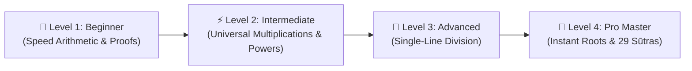

# Vedic Mathematics (वैदिकगणितम्)
### Beginner to Pro Master Computational Studio

> **"एकाधिकेन पूर्वेण | निखिलं नवतश्चरमं दशतः | ऊर्ध्वतिर्यग्भ्याम्..."**  
> *"Ancient mental math algorithms transforming complex arithmetic, algebra, division, and roots into single-line visual elegance."*

[](https://nikhilgajam.github.io/AncientWisdom/VedicMath/)
[](https://github.com/nikhilgajam/AncientWisdom/tree/main/VedicMath)

---

## 🌟 Overview & Pedagogical Curriculum

**Vedic Mathematics** is a comprehensive system reconstructed from intuitive appendices of the Atharvaveda between 1911 and 1918 by **Swami Bharati Krishna Tirtha** (1884–1960). It organizes arithmetic, algebra, and geometry into **16 Primary Sūtras** and **13 Upa-sūtras**.

This application provides a structured, interactive mastery curriculum taking learners from **Beginner to Pro Master**:



---

## 🧭 Four-Tier Mastery Framework

### 🌱 Level 1: Beginner Foundations (प्रारम्भिकः)
1. **Ekādhikena Pūrveṇa (एकाधिकेन पूर्वेण)**:
   - Squaring any number ending in 5: $n5^2 = [n \times (n+1)] \mid 25$.
   - Multiplication when unit digits sum to 10 and preceding digits are identical ($43 \times 47 = [4 \times 5] \mid [3 \times 7] = 2021$).
2. **Ekanyūnena Pūrveṇa (एकन्यूनेन पूर्वेण)**:
   - Instant multiplication by 9, 99, 999, etc. across all 3 cases (equal digits, more 9s, fewer 9s).
   - Example: $654 \times 999 \rightarrow (654 - 1) \mid (999 - 653) = 653,346$.
3. **Bījaṅka Checksum Engine (बीजाङ्क / नवांशावशेष)**:
   - The ancient modulo-9 digital root test. Validates addition, subtraction, multiplication, and squaring in 1 second.
   - Theorem: $\text{DR}(A \times B) \equiv \text{DR}(A) \times \text{DR}(B) \pmod 9$.

---

### ⚡ Level 2: Intermediate Universal Methods (मध्यमः)
1. **Ūrdhva-Tiryagbhyām (ऊर्ध्वतिर्यग्भ्याम्)**:
   - Universal cross-multiplication for numbers of any length (2-, 3-, 4-digit numbers and polynomials).
   - Visualizes ray steps, partial sums, and carry additions.
2. **Nikhilaṁ Navataścaramaṁ Daśataḥ (निखिलं नवतश्चरमं दशतः)**:
   - Base multiplication using deviations from powers of 10 ($10, 100, 1000, 10000$).
   - Cross-addition on LHS and vertical deviation multiplication on RHS.
3. **Dvandva Yoga (द्वन्द्वयोगः / The Duplex Method)**:
   - The fastest algorithm in mathematical history for squaring **any arbitrary number**:
     - $D(a) = a^2$
     - $D(ab) = 2ab$
     - $D(abc) = 2ac + b^2$
     - $D(abcd) = 2ad + 2bc$
   - Computes $345^2 = D(3) \mid D(34) \mid D(345) \mid D(45) \mid D(5) = 9 \mid 24 \mid 46 \mid 40 \mid 25 = 119,025$.
4. **Yāvadūnam (यावदूनम्)**:
   - Near-base squaring: $(B \pm d)^2 = (B \pm 2d) \mid d^2$.
   - Example: $96^2 = (96 - 4) \mid 4^2 = 9216$.
5. **Vinculum Algebra (रेखाङ्क / Bar Numbers)**:
   - Replaces heavy friction digits (6, 7, 8, 9) with negative bar complements ($\bar{d}$), transforming tedious borrow subtractions into mental additions.

---

### 🏹 Level 3: Advanced Single-Line Division (प्रौढः)
1. **Dhvajāṅka (ध्वजाङ्क — The Flag Method)**:
   - The crown jewel of Vedic arithmetic. Solves division for any 2-digit or multi-digit divisor in a single oral line without writing down long pages of trial subtractions.
   - Splits divisor into **Operator Digit** (which divides) and **Flag Digit** (which adjusts remainders).

---

### 👑 Level 4: Pro Grandmaster Roots & Canonical Corpus (पारङ्गतः)
1. **Vilokanam (विलोकनम् — By Observation)**:
   - Instant extraction of cube roots ($\sqrt[3]{N}$) for exact powers up to $1,000,000$ in 1–2 seconds!
   - Uses complementary units digit mappings (2 $\leftrightarrow$ 8, 3 $\leftrightarrow$ 7) and bounding cubic inequalities.
2. **Complete 29 Aphorisms Catalog**:
   - All **16 Primary Sūtras** (*Mūla-Sūtrāṇi*)
   - All **13 Upa-Sūtras** (*Upa-Sūtrāṇi*)
   - Interactive filtering by category with full Sanskrit names, English translations, mathematical formulas, and practical domains.

---

## 🛠️ How to Run Locally

```powershell
Start-Process index.html
```
Or launch from the root portal at `../index.html`.
